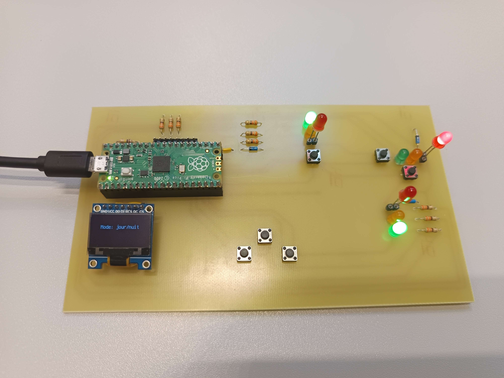

<a id="top"></a>
# Smart Traffic Light Controller — Raspberry Pi Pico

**[🇬🇧 English](#english) · [🇫🇷 Français](#francais)**



---

<a id="english"></a>
## 🇬🇧 English

> Two-lane traffic light controller with pedestrian priority, day/night modes, on-board settings menu and fault detection. Sequential logic designed as a GRAFCET, implemented in CircuitPython and in IEC 61131-3 languages on CODESYS.

**Context:** University project (SAÉ 4), BUT GEII — IUT de Rennes, 2025
**Team:** Adam Deruelle, Melvin Allard
**Stack:** Raspberry Pi Pico · CircuitPython · SPI OLED display · CODESYS (LD / ST / SFC)

### Features

- **Two traffic lights** (green / amber / red per lane) with a full alternating cycle
- **Pedestrian priority** via two push buttons
- **Vehicle detection** input (magnetic loop)
- **Day / night / automatic** operating modes
- **Settings menu** on an SPI OLED screen with three buttons (Menu / + / −) to tune each light duration live
- **Fault detection** on an analog input (threshold > 3 V): error displayed and lights frozen or switched off depending on the mode

### How it works

The behaviour was first modelled as a **GRAFCET** (sequential function chart), then translated step by step into code: each step is a variable (`X0`, `X10`, …), each transition is a boolean condition on timers and inputs, and outputs are recomputed every cycle — the same structure as a PLC program.

| Step | Lane 1 | Lane 2 |
|---|---|---|
| X0 | Green | Red |
| X10 → X20 | Amber → Red | Red |
| X30 → X50 | Red | Green → Amber |
| X60 | Red | Red → back to X0 |

Timings use a **`TON` class** (`Codes/timer.py`) that reproduces the IEC 61131-3 on-delay timer of industrial PLCs on a microcontroller.

### Repository layout

```
├── Codes/
│   ├── code1.py … code6.py   Incremental versions, from basic I/O to the complete program
│   ├── timer.py              TON on-delay timer class (PLC-style)
│   └── maintenance.py        OLED display & settings menu
├── InitiationCodesys/        Same logic in Ladder (LD), Structured Text (ST) and SFC on CODESYS
├── Contrôleur de feux de circulation.pdf   Project report (FR)
└── Feux de circulation - Codesys.pdf       CODESYS report (FR)
```

`code6.py` is the final, complete program.

### Run it

1. Flash CircuitPython on a Raspberry Pi Pico.
2. Copy `Codes/timer.py`, `Codes/maintenance.py` and `Codes/code6.py` (renamed `code.py`) to the `CIRCUITPY` drive.
3. The program starts automatically on boot.

### What I learned

- Designing sequential logic with GRAFCET and porting it to both a microcontroller and a PLC environment
- Embedded I/O: digital inputs/outputs, analog reading, SPI display
- Building a usable embedded user interface
- Incremental development: each version adds one feature and is tested before the next

[⬆ Back to top](#top)

---

<a id="francais"></a>
## 🇫🇷 Français

> Contrôleur de feux de circulation à deux voies avec priorité piéton, modes jour/nuit, menu de réglage embarqué et détection de panne. Logique séquentielle conçue en GRAFCET, implémentée en CircuitPython et dans les langages IEC 61131-3 sous CODESYS.

**Contexte :** Projet universitaire (SAÉ 4), BUT GEII — IUT de Rennes, 2025
**Équipe :** Adam Deruelle, Melvin Allard
**Stack :** Raspberry Pi Pico · CircuitPython · écran OLED SPI · CODESYS (LD / ST / SFC)

### Fonctionnalités

- **Deux feux de circulation** (vert / orange / rouge par voie) avec un cycle alterné complet
- **Priorité piéton** via deux boutons poussoirs
- Entrée de **détection de véhicule** (boucle magnétique)
- Modes de fonctionnement **jour / nuit / automatique**
- **Menu de réglage** sur écran OLED SPI avec trois boutons (Menu / + / −) pour modifier en direct la durée de chaque feu
- **Détection de panne** sur une entrée analogique (seuil > 3 V) : erreur affichée et feux figés ou éteints selon le mode

### Fonctionnement

Le comportement a d'abord été modélisé en **GRAFCET**, puis traduit étape par étape en code : chaque étape est une variable (`X0`, `X10`, …), chaque transition est une condition booléenne sur les temporisations et les entrées, et les sorties sont recalculées à chaque cycle — la même structure qu'un programme d'automate.

| Étape | Voie 1 | Voie 2 |
|---|---|---|
| X0 | Vert | Rouge |
| X10 → X20 | Orange → Rouge | Rouge |
| X30 → X50 | Rouge | Vert → Orange |
| X60 | Rouge | Rouge → retour à X0 |

Les temporisations utilisent une **classe `TON`** (`Codes/timer.py`) qui reproduit sur microcontrôleur la temporisation au travail IEC 61131-3 des automates industriels.

### Organisation du dépôt

```
├── Codes/
│   ├── code1.py … code6.py   Versions successives, des E/S de base au programme complet
│   ├── timer.py              Classe de temporisation TON (façon automate)
│   └── maintenance.py        Afficheur OLED et menu de réglage
├── InitiationCodesys/        Même logique en Ladder (LD), Structured Text (ST) et SFC sous CODESYS
├── Contrôleur de feux de circulation.pdf   Compte rendu du projet
└── Feux de circulation - Codesys.pdf       Compte rendu CODESYS
```

`code6.py` est le programme final complet.

### Lancer le projet

1. Installer CircuitPython sur une Raspberry Pi Pico.
2. Copier `Codes/timer.py`, `Codes/maintenance.py` et `Codes/code6.py` (renommé `code.py`) sur le lecteur `CIRCUITPY`.
3. Le programme démarre automatiquement à la mise sous tension.

### Ce que j'ai appris

- Concevoir une logique séquentielle en GRAFCET et la porter à la fois sur microcontrôleur et en environnement automate
- E/S embarquées : entrées/sorties numériques, lecture analogique, écran SPI
- Concevoir une interface utilisateur embarquée utilisable
- Développement incrémental : chaque version ajoute une fonctionnalité, testée avant de passer à la suivante

[⬆ Retour en haut](#top)
